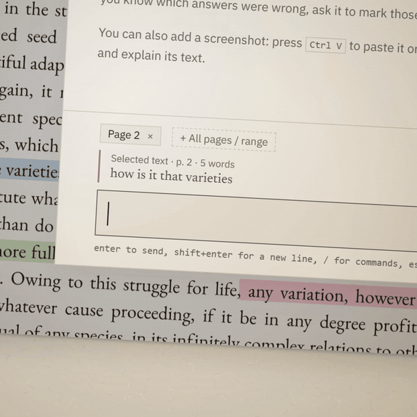

<div align="center">


# Okuma

**A calm PDF reader with an AI study partner.**
Highlight, take notes, ask questions about the page you're on, and turn chapters into quizzes. Your books never leave your browser.

[**Live demo →**](https://YOUR-DEMO-URL.vercel.app) &nbsp;·&nbsp; [Get a free Gemini key](https://aistudio.google.com/apikey) &nbsp;·&nbsp; English / Türkçe

<!-- Replace with a 20–40s screen recording (docs/demo.gif) -->


</div>

---

## Why

Reading a dense book usually means three apps: a PDF viewer, a notes app, and a chatbot you keep pasting paragraphs into. Okuma puts them on one page. The AI always knows which book, page and selection you mean, and everything you mark stays attached to the page.

## Features

**Reading**
- Fast PDF rendering, split view, generated table of contents for PDFs that have none
- OCR for scanned pages (runs in your browser with Tesseract)
- Seven reading themes and paper styles, keyboard shortcuts for everything (`?` to see them)
- Installable as an app, works offline after the first visit

**Marking up**
- Highlights in several colors, free-hand notes on the page, sticky notes
- A notes panel that collects every highlight, quote and AI answer you saved
- Export the PDF with your marks baked in

**AI (bring your own key)**
- Ask about the current page or a selection; the answer is grounded in the text and says when it uses outside knowledge
- Slash commands: summarize a range of pages, generate a quiz, build a vocabulary list, check your answers on a page of exercises
- Tap a word to translate it in the context of its sentence and save it to your word list
- Optional web search for questions that need up-to-date information
- Works with **Google Gemini** (free tier) or **OpenAI**

## Try it in 60 seconds

1. Open the [live demo](https://YOUR-DEMO-URL.vercel.app). A short welcome PDF opens with a few tips.
2. Reading, highlighting and notes work right away; no account, no key.
3. For AI features, click the **key icon** in the toolbar, choose **Gemini**, and paste a key from [Google AI Studio](https://aistudio.google.com/apikey) (sign in with Google → *Create API key* → copy). It's free and takes about 30 seconds.

## Privacy

- **Your PDFs, notes and highlights are stored only in your browser** (IndexedDB). There is no account and no database.
- **Your API key is stored only in your browser.** It is sent with your own AI requests to this app's API routes, which forward them to the provider and do not save or log it. The server has no key of its own, so nobody else can use AI through the demo on your behalf, or on the author's.
- When you use an AI feature, the relevant text (selection, page, or page range) is sent to the provider you chose.
- Because data lives in one browser, use **Backup** in the library to download a backup file, and restore it on another device.

## Self-hosting

Requires Node.js 20+.

```bash
git clone https://github.com/yusuf-ad/pdf-reader.git
cd pdf-reader
npm install
npm run dev
```

Open http://localhost:3000 and add your key from the key icon. No `.env` is needed.

To deploy, import the repo on [Vercel](https://vercel.com/new) with the default settings. Don't add any API keys as environment variables; the app doesn't read them.

## Tech stack

[Next.js](https://nextjs.org) 16 (App Router) · React 19 · TypeScript · Tailwind CSS 4 · [Vercel AI SDK](https://ai-sdk.dev) · [react-pdf](https://github.com/wojtekmaj/react-pdf) / pdf.js · [pdf-lib](https://github.com/cantoo-scribe/pdf-lib) · [Tesseract.js](https://tesseract.projectnaptha.com)

## License

[MIT](LICENSE)
